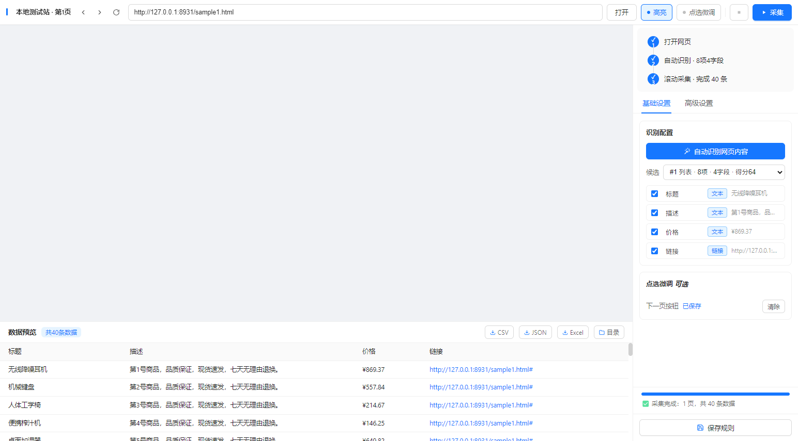
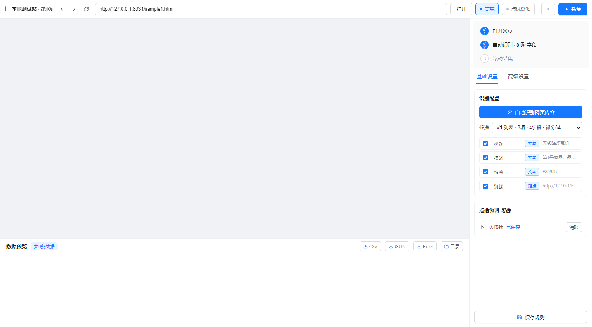
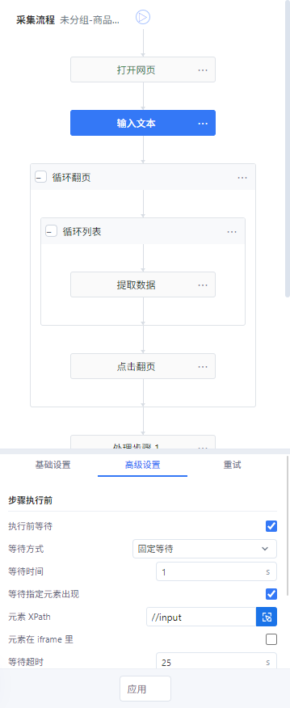
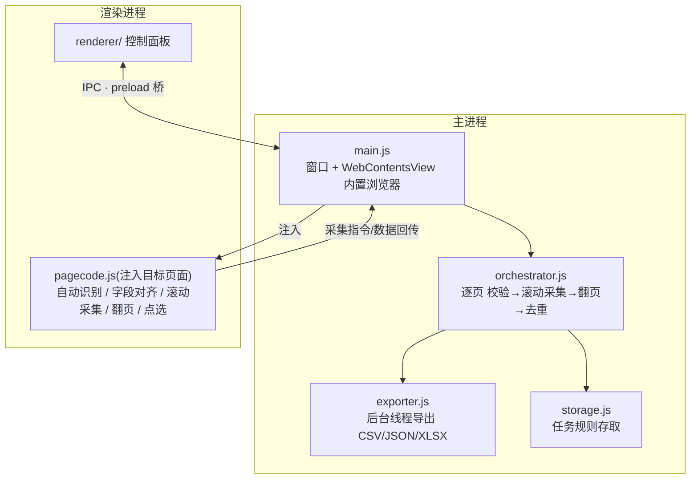

<div align="center">


# Collect Studio

**可视化网页数据采集工作台 —— 自动识别列表 · 滚动加载 · 流程树编排 · 分页与详情采集,一键导出结构化数据。**

Visual web scraping workbench: automatic list detection, infinite-scroll crawling, visual workflow tree, pagination & detail-page collection, exporting to CSV / JSON / Excel.

[截图](#-界面) · [功能特性](#-功能特性) · [使用流程](#-使用流程) · [架构](#️-架构) · [自动化测试](#-自动化测试)



</div>

---

类八爪鱼的桌面采集工具:Electron 桌面端 + 内置 Chromium 浏览器 + 自动识别 + 自动滚动采集。输入网址 → 自动识别列表 → 上下左右滚动加载 → 自动翻页 → 导出 CSV / JSON / Excel。**不需要写代码,也不需要浏览器扩展。**

## ✨ 功能特性

| 能力 | 说明 |
| :--- | :--- |
| **🔍 自动识别** | 遍历主页面与内部滚动区,分析 DOM 找出数据列表与字段,给出候选并立刻在页面上框选预览(列表项橙色框 + 字段蓝色框),识别质量一眼可判 |
| **✛ 点选微调** | 识别不准时在网页里直接点元素指定角色:列表项 / 字段 / 下一页按钮;「选择外层」「选中全部相似元素」扩大范围,自动转相对选择器 |
| **🌊 滚动采集** | 支持无限滚动、横向滚动、页内滚动区;有真实链接的翻页由主进程直接导航(比页内点击可靠),SPA 按钮则页内点击 |
| **🌳 流程树编排** | 打开网页 / 循环翻页 / 循环列表 / 提取数据 / 点击 / 输入 / 等待 / 滚动 / **进入详情并返回** 九类节点,拖拽排序、循环嵌套、复制粘贴、撤销删除 |
| **📁 多任务管理** | 同一站点可保存多个独立任务:搜索、分组、归档、另存副本;规则自动持久化,下次打开自动载入 |
| **🛡️ 可靠交付** | 后台线程导出与备份,实时预览合并更新减少界面阻塞;必填元素超时、表格缺列明确报错并保留已采数据;「恢复备份」找回已采集数据 |
| **📊 数据交付** | 导出 CSV(带 BOM,Excel 直接打开)/ JSON / Excel,采集全程实时去重,大数据量分批写入不卡界面 |

## 🖼 界面

| 自动识别 + 框选预览 | 流程树编排 |
| :---: | :---: |
|  |  |

## 🎯 使用流程

1. **输入网址** → 点「进入」,页面加载在右侧内置浏览器里
2. **点「🔍 自动识别」** —— 自动分析 DOM 找出数据列表,给出候选(可下拉切换)和字段(可勾选、可改名),并立刻在页面框选出来
3. **识别不对** → 换「候选」下拉重新框选,或点「✛ 开始点选」在网页里手动微调
4. **设置页数 / 滚动上限 → 「▶ 开始采集」** —— 自动滚动加载、自动翻页、实时去重
5. **导出 CSV / JSON / Excel**(results 目录)

## 🏗️ 架构



```
main.js               主进程:窗口 + WebContentsView 内置浏览器 + IPC
preload.js            面板桥
page-preload.js       目标页面桥(点选回传)
engine/
  pagecode.js         注入页面的核心:自动识别/字段对齐/滚动采集/翻页/点选
  orchestrator.js     采集编排:逐页 校验→滚动采集→翻页→去重
  exporter.js         CSV/JSON/XLSX 导出
  storage.js          任务规则存取
renderer/             左侧控制面板 UI
test/                 本地测试站(serve.js + 无限滚动/翻页样例页)
```

## 🚀 快速开始

```powershell
npm install          # 首次
npm start
```

- `tasks/`、`results/`、`output/` 为运行时目录,首次采集自动创建
- 窗口切后台不节流,采集不会被系统降速
- 强反爬站点(登录 / 验证码 / 风控)不在保证范围;验证码步骤支持人工完成后继续

## 🧪 自动化测试

```powershell
# 流程与布局 UI 测试(临时任务目录 + 本地测试站,不改已有任务)
npx electron test/workflow-ui.cjs
npx electron test/layout-ui.cjs

# 引擎端到端
node test\serve.js                                        # 本地测试站 :8931
AUTOTEST_URL=http://127.0.0.1:8931/sample1.html AUTOTEST_PAGES=2 AUTOTEST_SCROLLSEC=15 AUTOTEST_OUT=local npx electron . --autotest

# UI 全流程(真实点击 + 截图)
UITEST_URL=http://127.0.0.1:8931/sample1.html npx electron . --uitest
```

已验证:本地无限滚动站(40 条懒加载全采 + 翻页 12 条)、quotes.toscrape.com(3 页翻页 30 条)。

## License

[MIT](LICENSE)
